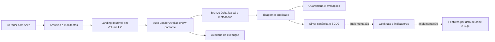

# Arquitetura NovaRota

Estado em 2026-10-23: Bronze demonstrada com 111 linhas; Silver demonstrada operacionalmente com 111 entradas reconciliadas e cenários principais observados em exports locais. A branch feature/gold-data-products implementa Gold e SQL analítico, ainda sem execução no Databricks. Verificação de falha/retomada permanece aberta.

## Fluxo de dados

Linhas contínuas representam o caminho Bronze e a primeira execução Silver informada. Linhas pontilhadas indicam Gold implementada, com demonstração remota pendente.

## Organização do código

O layout sugerido no briefing é mantido dentro de `src/novarota/`, um namespace próprio para imports locais, notebooks e empacotamento. A estrutura local `novarota-lakehouse-case/` corresponde à raiz de exemplo `case-senior/`. Dependências e execução são documentadas em requirements.txt e no guia local.

| Diretório | Responsabilidade | Estado |
| --- | --- | --- |
| src/novarota/config/ | Parâmetros, identificadores e caminhos derivados | Implementado |
| src/novarota/synthetic/ | Contratos materializados e massa determinística | Implementado |
| src/novarota/ingestion/ | Manifestos, publicação, Auto Loader, hash e reconciliação | Implementado |
| src/novarota/observability/ | Auditoria e logs por tentativa | Implementado |
| src/novarota/quality/ | Regras reutilizáveis e contratos tipados | Implementado; primeira execução concluída |
| src/novarota/silver/ | Canonização, SCD2, MERGE e controle de tentativas | Implementado; primeira execução concluída |
| src/novarota/gold/ | Produtos de consumo, features e controle de execução | Implementado; execução remota pendente |
| config/ | JSON de exemplo por ambiente, sem credenciais | Implementado |
| tests/ | Verificações locais e fixtures independentes | 34 testes na última execução anterior à reorganização |
| sql/ | Consultas analíticas versionadas | Implementado; execução remota pendente |
| notebooks/ | Entradas de execução e demonstração | Smoke, Bronze e Silver implementados |
| scripts/ | Build determinístico do pacote para importação | Implementado |
| docs/ | Arquitetura, decisões, contratos, guias e evidências | Mantido com cada mudança |

A verificação de integridade de arquivos permanece em ingestion; as regras de qualidade de negócio estão no módulo quality.

## Recursos da execução demonstrada

- Compute: Databricks Free Edition, Serverless.
- Catálogo: `workspace`.
- Bronze: `workspace.novarota_case01_bronze`, uma tabela por fonte com prefixo `bronze_`.
- Operação: `workspace.novarota_ops.pipeline_events`.
- Volume: `/Volumes/workspace/novarota_ops/case01_files`.
- Fontes: clientes/contas/cartões CDC em JSONL; transações, eventos de risco e estornos em CSV.

Catálogo, schema, dataset, seed e referência temporal são parâmetros. O setup usa recursos gerenciados e preserva dados e checkpoints existentes. A publicação ocorre fora da ingestão e conclui com manifesto; arquivos publicados são imutáveis.

## Incrementalidade e recuperação

Cada fonte possui checkpoint e schemaLocation independentes. A execução AvailableNow termina após processar o inventário disponível. A reconciliação de manifestos compara os arquivos/linhas e permite NOOP quando tudo já está persistido. Duplicatas de negócio e valores inválidos permanecem na Bronze. CSV adicional fica recuperável em rescue.

Dados e auditoria não são uma transação única. Uma tentativa é identificada por run_id; lote lógico usa batch_id. Erros são registrados e propagados. Recuperação deve reconciliar o estado; não excluir checkpoint para corrigir regra de negócio. [Runbook Bronze](bronze-runbook.md).

## Evolução Silver

A Silver implementa tipagem, quarentena, reavaliação de referências, ledger CDC, SCD2 e canonização financeira. Os intervalos de vigência são semiabertos, com sequência da origem para desempate, conflitos explícitos e lacunas quando um evento é rejeitado. O processamento relê um snapshot completo das seis fontes, fixado por versões Delta, e persiste staging Parquet por tentativa. Os destinos gerenciados são sincronizados por MERGE escopado pelo dataset e reconciliados antes da conclusão. Ver [contratos](silver-contracts.md), [runbook](silver-runbook.md), [primeira execução](evidence/silver-demo-succeeded.md) e ADR-005. Cenários adversos e retomada ainda exigem demonstração própria.

Gold calcula fato, dimensões, comportamento, risco e features sobre versões Delta fixadas da Silver concluída, com MERGE e estado de execução próprio. O corte de features só aceita datas a partir da conclusão do snapshot Silver consumido; a Gold não oferece reconstrução de cortes anteriores para treino retrospectivo. Ver [contratos](gold-contracts.md) e [runbook](gold-runbook.md).

## Evidência e limites

[Resumo Bronze](evidence/bronze-demo-passed.md): transcrição fornecida pelo candidato. A amostra anterior foi conferida no navegador. Export do notebook com outputs ainda complementará a entrega final. O perfil sample demonstra correção funcional; não mede escala de produção.

[Resumo Silver](evidence/silver-demo-succeeded.md): JSON final fornecido pelo usuário. Três CSVs de cenários foram examinados localmente e permaneceram fora do Git por solicitação do usuário. Gold ainda não possui output remoto.

A reorganização moveu config.py para config/__init__.py com imports públicos preservados e ajustou as expectativas do teste de empacotamento. A suíte não foi reexecutada nessa etapa; os 34 testes aprovados são evidência anterior à reorganização.
