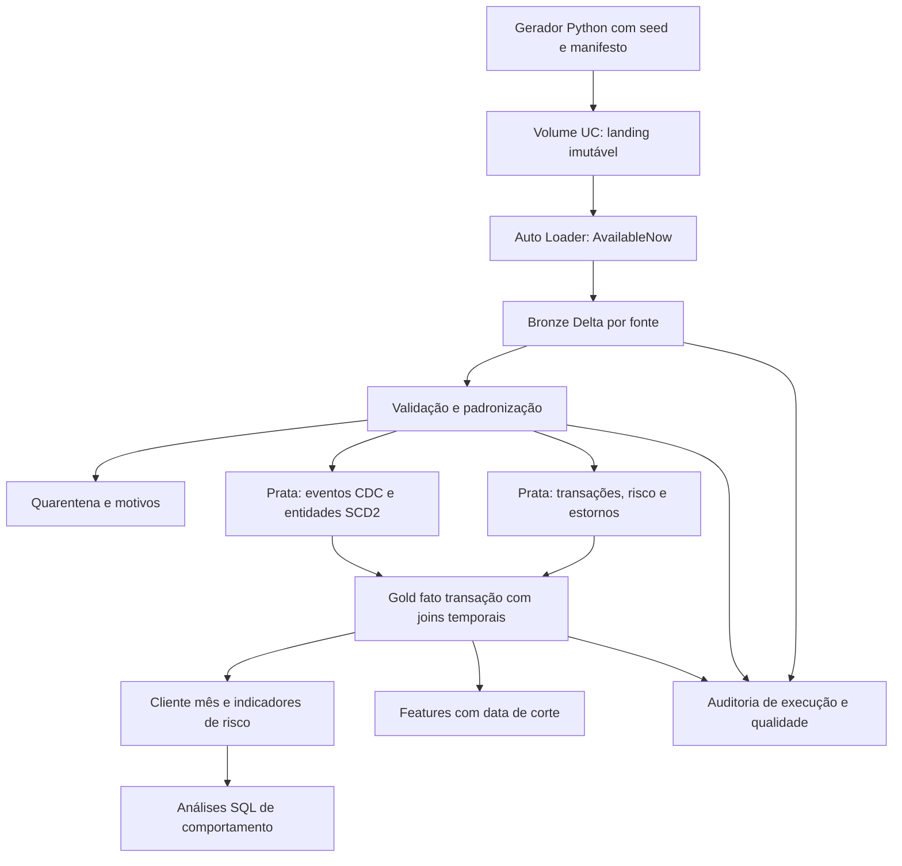

# Exploração da solução NovaRota

Data: 2026-10-25. Estado: fundação, Bronze, Silver e implementação Gold concluídas; as execuções Bronze, Silver e Gold foram informadas pelo candidato e têm resumos versionados. SQL analítico ainda não executado com evidência, cenários individuais e retomada Silver ainda sem exports, e branch Gold ainda não integrada em develop/main. As decisões abaixo distinguem implementação, execução informada e validação que falta.

## Problema e resultado esperado

A cooperativa precisa analisar comportamento transacional, perdas e risco, e disponibilizar features para Data Science. O produto deve manter resultados coerentes mesmo com duplicatas, mudanças cadastrais, estornos e arquivos fora de ordem.

O briefing exige Databricks, Delta Lake, Bronze/Prata/Ouro, ingestão incremental, qualidade com quarentena, histórico de dimensões ou justificativa, MERGE, SQL avançado, Python modular, testes, Git e evidências reais de execução. Esses são critérios de aceite do case. As opções abaixo são decisões propostas para atendê-los.

O ambiente utiliza Databricks Free Edition e dados exclusivamente sintéticos.

## Arquitetura alvo

Fluxo finito por execução: processar arquivos disponíveis, encerrar a Bronze, executar Prata e Ouro na ordem de dependência. Evitar stream-to-stream joins no case. Notebooks serão pontos de entrada pequenos para um pacote Python e consultas SQL versionadas.

## Ambiente e execução

- Catálogo parametrizável: usar um catálogo existente permitido no workspace; não presumir permissão para criar outro.
- Schemas propostos: `novarota_bronze`, `novarota_silver`, `novarota_gold` e `novarota_ops`.
- Volume gerenciado em `novarota_ops`, com subdiretórios separados para landing, checkpoints, schemas e manifestos. Dados de tabela ficam em tabelas Delta gerenciadas.
- Auto Loader em directory listing e `AvailableNow`; um checkpoint e um diretório de schema por fonte. Arquivos publicados são imutáveis.
- Executar fontes sequencialmente no perfil pequeno. Um Databricks Workflow deve encadear Bronze → Silver → Gold por dependência, passar catalog/dataset/profile/data de corte como parâmetros e permitir no máximo uma execução concorrente por dataset. A conta do case não tem um Job versionado/provisionado; esse agendamento permanece desenho operacional.
- Não depender de bucket cloud externo, DBFS mounts, RDDs ou configuração de cluster clássico.
- Setup, gerador, carga de lotes e pipeline devem funcionar dentro do workspace usando recursos disponíveis. Execução local auxilia testes; evidência local não substitui execução Databricks.

Free Edition é serverless e tem cotas. Volumes, Auto Loader e criação de schemas foram exercitados na amostra inicial. A demonstração das seis fontes também concluiu, conforme o [resumo fornecido pelo candidato](evidence/bronze-demo-passed.md). Isso confirma o caminho do case na amostra, sem demonstrar desempenho em escala.

## Dados e lacunas do briefing

Usar seis fontes: clientes CDC, contas CDC e cartões CDC em JSON Lines; transações, eventos de risco e estornos em CSV. Arquivos de transações serão organizados por data do evento, independentemente da data em que chegam.

Perfis implementados: sample com 10 clientes iniciais e 40 transações de fundo; demo com 100 clientes e 10 mil transações de fundo. Fixtures acrescentam versões, duplicatas e valores inválidos. Ambos foram gerados localmente; a execução Bronze informada usa sample e contém 111 linhas nas seis fontes. A massa demo ainda não foi demonstrada no Databricks.

| Lacuna ou ambiguidade | Decisão proposta |
| --- | --- |
| Estornos parciais sem campo de valor | Acrescentar `valor_estorno` e `moeda` ao mínimo do enunciado. |
| Transações canceladas sem campo de status | Acrescentar `status_transacao`, `data_atualizacao` e `sequencia_origem`. |
| CDC sem identidade de evento e desempate | Acrescentar `id_evento_cdc` e `sequencia_origem`; `data_atualizacao` representa vigência de negócio neste case. |
| Moedas diferentes sem taxa de conversão | Perfil de indicadores em BRL; preservar outras moedas na Bronze e segregar conversões sem taxa na Prata. Não somar valores de moedas distintas. |
| Estabelecimento sem identificador próprio | Acrescentar `id_estabelecimento` e manter o nome como atributo. |
| Chargeback potencialmente duplicado em eventos | Usar `id_evento` e `tipo_evento` como contrato; chargeback é indicador de risco e não desconta valor novamente como estorno. |
| Conflitos CDC no mesmo instante | Ordenar por vigência e sequência da origem; conflitos com mesma identidade/versão e conteúdo diferente vão para quarentena. |

Os campos são extensões permitidas de campos mínimos, e serão documentados nos contratos. CPFs serão identificadores fictícios produzidos pelo gerador; nomes usarão rótulos como `Cliente Sintetico 0001`, sem dados de pessoas reais.

## Regras de negócio propostas para as mudanças seguintes

### Histórico, atraso e idempotência

Na Bronze, preservar duplicatas de negócio e registrar cada arquivo novo uma vez por checkpoint estável. Na Prata, deduplicar identidades e versões da origem antes do MERGE. O hash do payload exclui metadados de execução; `batch_id` identifica o lote lógico e `run_id` a tentativa de execução.

Manter um registro de eventos CDC e reconstruir a linha temporal somente das chaves afetadas, considerando todo o histórico de eventos dessas chaves. Usar intervalos semiabertos `[valid_from, valid_to)` e seleção temporal sem sobreposições. Isso corrige também eventos atrasados que entram entre duas versões existentes. Um CDC atrasado pode exigir recalcular transações e agregações históricas afetadas.

SCD2 para cliente, conta e cartão, com deleções lógicas e preservação de histórico. Os relacionamentos cartão → conta → cliente serão resolvidos nas versões vigentes no instante da transação. Um cartão cancelado depois da compra mantém essa compra no histórico; compras na vigência cancelada ficam fora dos indicadores elegíveis.

Reprocessamento receberá intervalo de datas de evento, separado do lote de ingestão. Atrasos sem limite fixo continuam recuperáveis a partir da Bronze; a demonstração terá um horizonte pequeno e explícito.

### Ouro e semântica financeira

| Produto | Grão e regra principal |
| --- | --- |
| `gold_fato_transacao` | Uma linha por `id_transacao` canônico, com valores bruto, estornado, líquido, elegibilidade e chaves das versões temporais. |
| Dimensões Gold | Cliente, conta e cartão preservam identidade e validade da Prata; estabelecimento tem chave estável da origem. |
| `gold_cliente_mes` | Uma linha por cliente e mês de transação, em BRL, com gasto líquido, quantidade, ticket, diversidade e variação mensal. |
| `gold_indicadores_risco` | Uma linha por cliente e mês da transação, com contagens de eventos e estornos previamente agregados por transação para evitar multiplicação em joins. |
| `gold_features_cliente` | Uma linha por cliente e `data_referencia`, com janelas retrospectivas e disponibilidade da informação respeitada. |

Uma transação de R$ 100 com estorno de R$ 30 contribui R$ 70 no líquido; estorno integral contribui zero. Somatório de estornos acima do original gera inconsistência explícita. Transações canceladas ou inválidas ficam identificáveis na fato e não contribuem para métricas elegíveis. Estornos são atribuídos ao mês da compra nesta visão de comportamento; uma visão de fluxo financeiro por data do estorno é evolução futura.

Indicadores operacionais podem ser corrigidos retroativamente à medida que dados chegam. Features destinadas à avaliação de modelos usam apenas fatos com tempo do evento e primeira disponibilidade anteriores à data de corte; manter histórico suficiente de versões para reconstruir o que era conhecido. Não reutilizar silenciosamente uma visão corrigida com dados futuros como dataset de treino.

### SQL e qualidade

| Exigência | Demonstração planejada |
| --- | --- |
| CTEs encadeadas e ROW_NUMBER | Canonização de versões, deduplicação e análise de risco em etapas. |
| LAG / LEAD | Variação mensal e validade de dimensões históricas. |
| FIRST_VALUE / LAST_VALUE | Primeiro comportamento elegível, com frame explícito. |
| NTILE / percentis | Segmentação de gasto e comparação com pares. |
| Anomalia e histórico próprio | Comparar período atual com baseline anterior do cliente, tratando histórico curto e variância zero. |
| Cidade / segmento | Comparar com pares vigentes no corte; exigir grupo mínimo e evitar dados futuros. |
| MERGE INTO | Aplicar eventos canônicos e reconstruções por chaves afetadas. |

Quarentena preserva payload, origem, etapa, códigos de regras e identificação do lote. Problemas recuperáveis de referência podem ser reavaliados quando o cadastro atrasado chega. Falhas de infraestrutura, contrato obrigatório ou escrita devem interromper a etapa; não convertê-las em sucesso com linhas descartadas.

## Operação, performance e governança

Começar sem particionamento físico nas tabelas pequenas; as pastas da fonte não impõem particionamento Delta. Na amostra, evitar uma escrita por evento e agrupar a saída por lote/fonte para não criar arquivos minúsculos. Em produção, acompanhar quantidade e tamanho de arquivos e compactar conforme o volume e a capacidade suportada; definir particionamento ou clustering somente após observar cardinalidade e filtros. Avaliar `OPTIMIZE` conforme suporte e tamanho. Não acrescentar ZORDER ou Liquid Clustering como demonstração sem justificar e verificar disponibilidade.

Usar explain e query profile disponível no serverless para discutir estratégia de joins, filtros e eventual broadcast de dimensões pequenas; não alegar ganho de escala a partir da amostra do case. Observar linhas de entrada, aprovadas, rejeitadas, duplicatas, duração e falhas por etapa em tabelas de auditoria, com logs estruturados do aplicativo.

Documentar papéis de ingestão, transformação, consumo Gold e Data Science em Unity Catalog. Demonstrar apenas permissões que a conta permitir; administração corporativa, rede privada e operação com SLA ficam como desenho de produção.

## Etapas de implementação

1. `bootstrap-synthetic-bronze`: setup reproduzível, contratos sintéticos, lotes determinísticos, Auto Loader e Bronze com metadados. Concluída e arquivada em 2026-10-23.
2. Silver: contratos tipados, quarentena, SCD2, MERGE, atrasos e reprocessamento implementados na feature/dq-and-scd. A primeira execução real reconciliou 111 entradas; critérios adversos ainda exigem evidência específica.
3. Gold: fato, dimensões, agregações, features com corte temporal e SQL avançado implementados na feature/gold-data-products. A primeira execução Gold foi informada como concluída; faltam a evidência dos valores por cenário e a execução da consulta SQL.
4. `demonstrate-integrated-case`: reunir exports com outputs Bronze/Silver/Gold, validar cenários temporais e financeiros, executar SQL, acrescentar cobertura direta das transformações Spark Silver/Gold e integrar a branch Gold em develop/main. A suíte local passou com 34 testes em 2026-10-25; os testes atuais não exercitam diretamente essas transformações.

Git deverá registrar evolução real com conventional commits. Não fabricar commits retroativos. A entrega poderá ser repositório privado ou pacote preservando o histórico Git, conforme combinado com o avaliador.

## Referências consultadas

- https://docs.databricks.com/aws/en/getting-started/free-edition-limitations
- https://docs.databricks.com/aws/en/compute/serverless/limitations
- https://docs.databricks.com/aws/en/compute/serverless/streaming
- https://docs.databricks.com/aws/en/ingestion/cloud-object-storage/auto-loader/schema

## Próxima validação

Consultar e registrar os cenários específicos de atraso, conflito, replay e recuperação na Silver; conferir os valores financeiros e temporais na Gold; executar a consulta SQL e guardar Query Profile. A entrega final deverá complementar os resumos com exports dos notebooks incluindo outputs. IDs de catálogo, schema e Volume permanecem parâmetros de setup.
